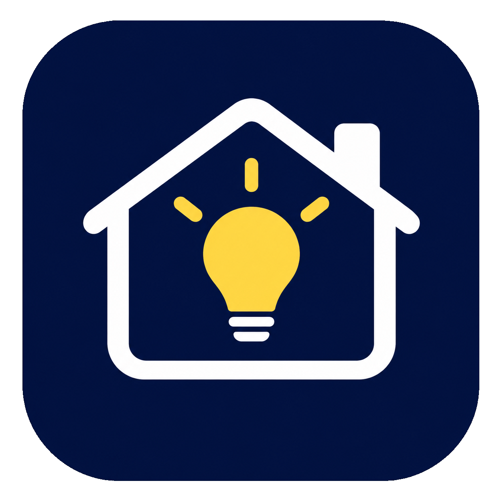

# SmartLights

**Todas tus bombillas, en una sola app.**

Sin cuenta, sin nube y sin servidor. La app habla directamente con tus bombillas
por la WiFi de casa.

---

## La idea

Tener las bombillas WiZ en una app y la Tapo en otra significa saltar de una a
otra para encender la luz del salón. SmartLights junta las dos marcas en una
pantalla, con el mismo control para todas.

No hay ningún servidor de por medio: el móvil manda las órdenes a cada bombilla
por la red local. Por eso responde rápido y funciona aunque no haya internet.

---

## 💡 Controlar

**Brillo, blanco y color.** Una barra de brillo y dos pestañas: **Blanco**, con un
degradado de cálido a frío y su valor en kelvin, y **Color**, con un panel donde
eliges tono y saturación arrastrando el dedo.

**Preajustes de color.** Una fila de colores a un toque, y cada uno guarda
también el **brillo**. Mantén pulsado uno para guardar ahí el color actual,
borrarlo o restablecerlos. Con **+** guardas el que tengas puesto.

**El icono te dice cómo está.** La bombilla de cada tarjeta se ilumina con el
color y el brillo reales de la luz, y responde al instante, sin esperar a que la
bombilla conteste.

**Un botón para todas.** Arriba, junto al de actualizar: si hay alguna
encendida las apaga todas, y si no, las enciende.

---

## 🛋️ Habitaciones

**Agrupa y controla a la vez.** Crea una habitación («Salón», «Oficina»…), marca
qué bombillas entran y se manejan juntas, con los mismos controles que una
bombilla suelta. Puedes mezclar WiZ y Tapo, y una bombilla puede estar en varias
habitaciones.

**Cada una a lo suyo.** Si una bombilla no tiene color, solo recibe lo que
entiende. Si una no responde, las demás cambian igualmente y la app te avisa de
cuál falló.

**Dos pestañas, deslizando.** **Bombillas** y **Habitaciones** se cambian tocando
o deslizando el dedo, y la app recuerda en cuál te quedaste.

---

## ⏰ Programar la Tapo

**Se guarda en la bombilla.** Las programaciones viven dentro de la propia Tapo y
se ejecutan solas, aunque el móvil esté apagado o fuera de casa.

**Encender de forma gradual.** Elige hora, días de la semana, brillo final, blanco
o color, y cuántos minutos tarda en subir. También puedes programar un apagado.

**Compatible con la app oficial.** Las reglas que crees aquí aparecen allí, y al
revés. Puedes activarlas, editarlas y borrarlas desde SmartLights.

---

## 🔒 Privacidad

**Sin cuenta ni servidor.** No hay registro, anuncios ni telemetría. Lo que
configuras se queda en tu teléfono.

**La contraseña de Tapo, cifrada.** Se guarda con AES-256-GCM, con una clave que
vive en el **Android Keystore** y que la propia app no puede extraer.

**Una advertencia honesta.** Las bombillas hablan por HTTP y UDP sin cifrar dentro
de tu red local, porque es lo que ofrecen. Úsalo en una WiFi de confianza.

---

## Qué bombillas funcionan

| Marca | Cómo habla | Qué necesita |
|---|---|---|
| **WiZ** | UDP, puerto 38899 | Activar el **control local** en la app oficial de WiZ |
| **Tapo** (TP-Link) | Protocolo TPAP sobre HTTP | El email y la contraseña de tu cuenta Tapo |

Está probada con dos WiZ de color y una Tapo de color. Otros modelos pueden
funcionar, pero no los he podido comprobar.

**Límites conocidos.** Las WiZ no bajan del 10 % de brillo. De Tapo solo está
soportada la variante de TPAP sin TLS (`tls=0`, suite 1, `aes_128_ccm`): si tu
modelo exige otra, la app te dirá cuál. Necesita Android 8 o superior.

---

## Créditos

El soporte del protocolo **TPAP de Tapo** está portado de
[plugp100](https://github.com/petretiandrea/plugp100), de Andrea Petreti, bajo
GPL-3.0. El formato de las órdenes de programación lo confirmé leyendo la
librería [tapo](https://github.com/mihai-dinculescu/tapo), de Mihai Dinculescu.

El código de SmartLights es libre, con [licencia GPL-3.0](LICENSE). Elegí esa
licencia porque parte del código deriva de plugp100, que la usa.

---

¿Quieres compilarla, trastear el código o aportar?
**[Guía de desarrollo →](docs/DESARROLLO.md)**

